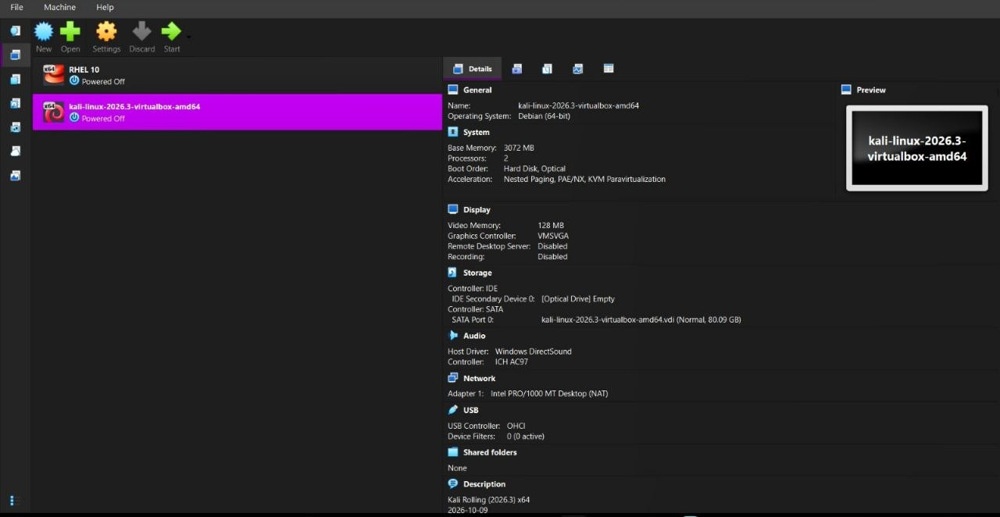
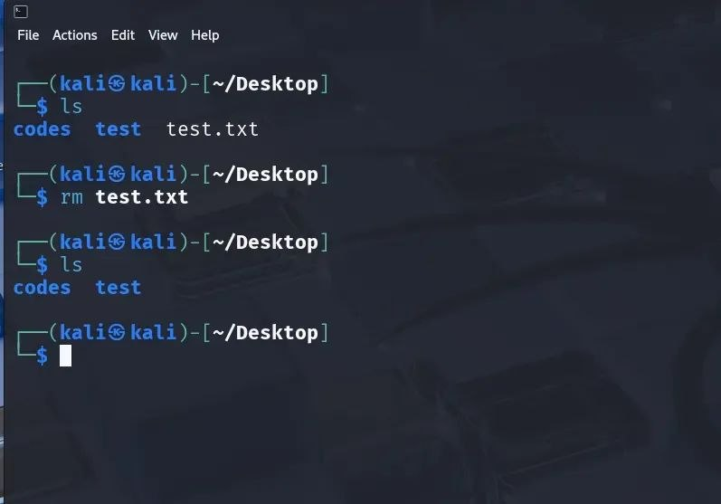

\# Cybersecurity Internship - Network Walks

\## 🚀 Task 1: Lab Setup (Kali Linux on VirtualBox)

\### Objective

Configure a secure virtualization environment using Oracle VM VirtualBox and install Kali Linux to serve as the primary penetration testing and network analysis workstation.

\---

\## 🛠️ Environment Specifications

\* Host Operating System: Windows 

\* Hypervisor: Oracle VM VirtualBox (v7.x)

\* Guest Operating System: Kali Linux (64-bit Rolling)

\* Allocated Resources:

&#x20; \* RAM: 3 GB (3072 MB)

&#x20; \* CPU Cores: 2 Cores

&#x20; \* Storage: 80.09 GB (Virtual Disk Image)

&#x20; \* Network Adapter: NAT (Network Address Translation)

\---

\## 📝 Step-by-Step Implementation

1\. Virtual Machine Provisioning:

&#x20;  \* Downloaded the pre-built VirtualBox 64-bit Kali Linux image from the official documentation.

&#x20;  \* Imported the appliance into Oracle VM VirtualBox Manager and allocated 3 GB RAM and 2 CPU cores.

2\. First Boot \& Authentication:

&#x20;  \* Powered on the virtual machine and logged into the Kali desktop environment using default credentials (kali / kali).

3\. Network Interface Verification:

&#x20;  \* Opened a terminal instance within the guest OS and ran configuration utilities to verify active network adapters and IP assignment (eth0 interface via NAT).

\---

\## 📷 Lab Evidence / Screenshots

\### 1. VirtualBox Manager

\### 2. Lab Setup View

\### 3. Kali VirtualBox Settings \& Terminal

